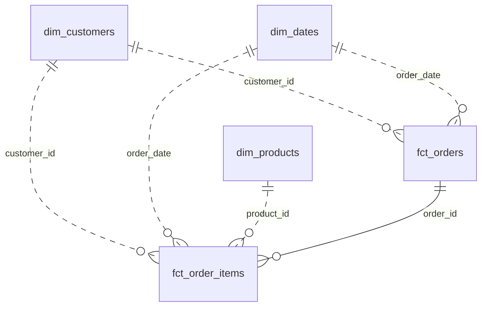
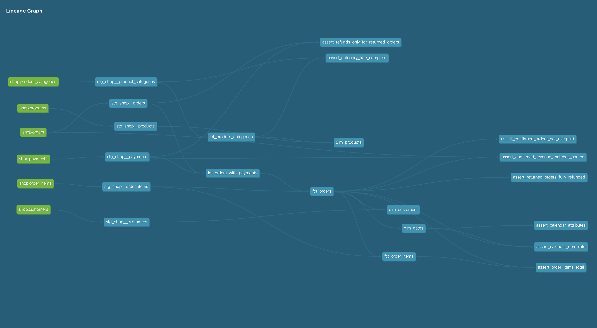

# store_hse

Аналитическое хранилище интернет-магазина на Greenplum и dbt. Данные из PostgreSQL загружаются в `raw`, проходят через слои `staging` и `intermediate` и используются для построения пяти витрин в `analytics_marts`

## Модель данных

| Витрина | Зерно | Бизнес-вопрос |
| --- | --- | --- |
| `fct_orders` | Один нетестовый заказ | Сколько подтверждённых заказов было за период и на какую сумму? |
| `fct_order_items` | Один товар в одном нетестовом заказе | Какие товары принесли больше всего выручки по подтверждённым заказам? |
| `dim_customers` | Один зарегистрированный клиент | Когда клиент впервые совершил подтверждённую покупку и сколько потратил на подтверждённые заказы? |
| `dim_products` | Один товар | К какой категории, родительской и корневой категории относится товар? |
| `dim_dates` | Один календарный день между первой и последней датами нетестовых заказов | Как меняется выручка по месяцам, будням и выходным при соединении с заказами? |

### Хранение в Greenplum

| Витрина | Распределение | Хранение | Обоснование                                                                                                                                                                |
| --- | --- | --- |----------------------------------------------------------------------------------------------------------------------------------------------------------------------------|
| `fct_orders` | `DISTRIBUTED BY (order_id)` | `heap` | Совпадает с ключом распределения позиций, заказ и его позиции можно соединить на одном сегменте                                                                            |
| `fct_order_items` | `DISTRIBUTED BY (order_id)` | `heap` | Все попадает на один сегмент, подходит для соединения и агрегации по заказу                                                                                                |
| `dim_customers` | `DISTRIBUTED BY (customer_id)` | `heap` | Ключ совпадает с зерном витрины и распределением `raw.customers`. При соединении с фактами по клиенту может потребоваться пересылка строк, тк факты распределены по заказу |
| `dim_products` | `DISTRIBUTED REPLICATED` | `heap` | Витрина небольшая, поэтому копию можно хранить на каждом сегменте и соединять с позициями локально                                                                         |
| `dim_dates` | `DISTRIBUTED REPLICATED` | `heap` | Календарь небольшой,на каждом сегменте доступна копия для локального соединения с обоими фактами                                                                           |

`raw.orders`, `raw.order_items` и `raw.payments` также распределены по `order_id`. Если распределять позиции по `product_id`то строки одного заказа могут оказаться на разных сегментах, а по `order_id` Greenplum тогда может потребоваться переслать строки между сегментами

### Граф зависимостей dbt

## Обязательный дополнительный вариант: dbt_utils

Модель `dim_dates` использует `dbt_utils.date_spine` с шагом в один день,
границы берутся из `fct_orders` от минимальной даты нетестового заказа до максимальной включительно, к максимальной дате прибавлен один день.
Нумерация дней недели: понедельник 1, воскресенье 7; выходные — суббота и воскресенье

## Проверки данных

через `docker compose run --rm dbt test`.
Ключи staging и marts проверяются на уникальность и отсутствие NULL,
внешние ключи фактов проверяются на наличие строки в соответствующем измерении.
Дженерик `non_negative` применён к стоимости заказа и позиции,
четыре обязательные бизнес-проверки сверяют суммы заказов и позиций,
выручку с исходными заказами и платежами, полноту возвратов и переплаты

Получился WARN: `assert_confirmed_orders_not_overpaid` на заказе 113, заказ 200 рублей, но операции списали 400 рублей.
предупреждение сообщает о реальной проблеме, а стоимость покупки в выручке остаётся 200 рублей.
